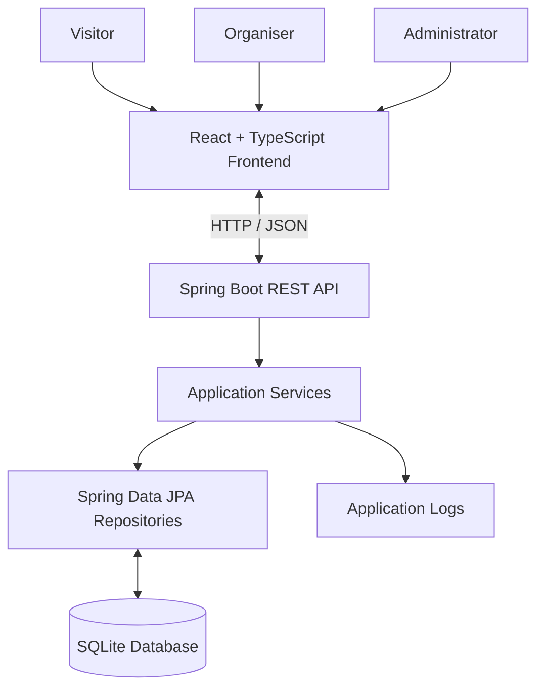

# Community Events Platform

A full-stack web application for managing community events, handling visitor registrations, and reviewing events before publication. The application uses React and TypeScript for the frontend, Java and Spring Boot for the backend, and SQLite for persistent storage.

## Table of Contents

- [Features](#features)
- [Technology Stack](#technology-stack)
- [Architecture](#architecture)
- [Data Model](#data-model)
- [Prerequisites](#prerequisites)
- [Setup and Running](#setup-and-running)
- [Testing](#testing)
- [Demonstration Guide](#demonstration-guide)
- [Trade-offs and Future Improvements](#trade-offs-and-future-improvements)
- [AI-Use Declaration](#ai-use-declaration)

## Features

### Visitors

- Browse published community events.
- View event descriptions, dates, and capacity.
- Register for events without creating an account.

### Organisers

- Create events for review.
- View and manage their own events.
- Edit existing events.

### Administrators

- Review events awaiting approval.
- Publish or reject events awaiting review.

### Additional functionality

- SQLite persistence using Spring Data JPA and Hibernate.
- Server-side validation for event data.
- Application logging for event publication and registration creation.
- Automatic sample data seeding when the events database is empty.

## Technology Stack

| Area | Technology |
|---|---|
| Frontend | React, TypeScript |
| Frontend tooling | Node.js, npm |
| Backend | Java, Spring Boot |
| API | Spring Web / REST |
| Persistence | Spring Data JPA, Hibernate |
| Database | SQLite |
| Validation | Jakarta Bean Validation |
| Design assistance | Figma AI |

The frontend communicates with the backend through HTTP requests. The backend handles application logic, validation, and database operations. SQLite was selected as a lightweight database that does not require a separate database server.

## Architecture

The application follows a layered backend architecture, separating the REST API, application services, repositories, and database.



### Request flow

1. A user interacts with the frontend.
2. The frontend sends an HTTP request to the relevant API endpoint.
3. The backend processes the request and applies the relevant validation and business rules.
4. Repositories read or update data in SQLite.
5. The backend returns a response to the frontend.
6. Important operations are recorded in the application logs.

## Data Model

### Event

Represents a community event.

| Field | Description |
|---|---|
| `id` | Unique event identifier |
| `title` | Event title |
| `description` | Event description |
| `eventDate` | Scheduled date and time |
| `capacity` | Maximum intended number of registrations |
| `status` | Current event status |
| `organiserId` | Identifier of the responsible organiser |

Events can be awaiting review, published, or rejected.

### Registration

Represents a visitor's registration for an event. Registration records are persisted in SQLite and associated with an event. Visitors do not need to create an account to register.

### Notifications and activity

A separate notification table and recent-activity interface were not implemented. Instead, application logs record key operations, including event publication and registration creation.

## Prerequisites

- **Git** to clone the repository.
- **Node.js and npm** to install and run the frontend.
- **Java JDK** matching the backend's configured Java version.
- **Maven** or the Maven Wrapper included in the repository.

SQLite is embedded in the application, so no separate database server is required.

## Setup and Running

### 1. Clone the repository

```bash
git clone https://github.com/Diego620/community-events.git
cd community-events
```

### 2. Start the backend

Open a terminal in the backend directory containing `pom.xml`.

If the project includes the Maven Wrapper, run the appropriate command.

**Windows**

```powershell
.\mvnw.cmd spring-boot:run
```

**Linux/macOS**

```bash
./mvnw spring-boot:run
```

Alternatively, if Maven is installed:

```bash
mvn spring-boot:run
```

The backend is configured to use:

`http://localhost:8080`

If the port is already in use, stop the other process or change the backend's configured port.

### 3. Database and sample data

The application uses SQLite with the configured database URL:

```properties
spring.datasource.url=jdbc:sqlite:events.db
```

The `DataSeeder` component inserts sample events only when the events database contains no existing events.

The sample data includes:

- **Beach Cleanup:** Published event.
- **Community Book Swap:** Event awaiting review.
- **Local Repair Café:** Event awaiting review.

These records use fictional descriptions and organiser identifiers.

To restore the initial sample state, start with an empty local database and launch the backend. The seeder will insert the sample events automatically.

The SQLite database file is local runtime data and should not be committed to the repository. The seeder provides a repeatable way to generate sample data.

### 4. Start the frontend

Open another terminal in the frontend directory containing `package.json`.

Install dependencies:

```bash
npm install
```

Start the development server:

```bash
npm run dev
```

The frontend is expected to be available at:

`http://localhost:5173`

Use the URL displayed in the terminal if a different port is selected.

### 5. Configuration

Ensure the frontend is configured to communicate with the backend at `http://localhost:8080`. If the project uses an environment variable for the API base URL, configure it according to the frontend's existing configuration.

No separate SQLite service or database credentials are required for the default local setup.

## Testing

### Backend tests

From the backend directory, run the available Maven test command.

**Windows with Maven Wrapper**

```powershell
.\mvnw.cmd test
```

**Linux/macOS with Maven Wrapper**

```bash
./mvnw test
```

Alternatively:

```bash
mvn test
```

### Frontend tests

Check the frontend's `package.json` for an available test script. If no automated frontend test script is configured, verify the frontend manually using the workflows below.

### Scenarios to verify

- Published events are visible to visitors.
- Events awaiting review are not displayed as published events.
- Visitors can register for published events.
- Registration data persists in the database.
- Organisers can create and edit events.
- Administrators can publish or reject events awaiting review.
- Invalid event data is rejected by applicable backend validation.
- Sample events are seeded when the database is empty.
- Event publication and registration creation appear in application logs.

Automated test results should only be reported as passing after the tests have actually been run.

## Demonstration Guide

### 1. Visitor workflow

1. Start the backend and frontend.
2. Open the application as a visitor.
3. Browse the published events. 
4. Register for the event using the registration form. 
5. Verify the registration where supported by the interface. 
6. Check the backend terminal for the registration creation log.

### 2. Organiser workflow

1. Access the organiser functionality.
2. Create an event with a title, description, date, and capacity.
3. Submit the event for review.
4. Verify its status.
5. Edit an existing event and save the changes.
6. Verify that the changes persist.

**Note:** Editing an event does not reset its status to `PENDING_REVIEW`. See the known limitations below.

### 3. Administrator workflow

1. Access the administrator functionality.
2. View events awaiting review.
3. Select an event awaiting review.
4. Publish the event.
5. Verify that it becomes visible to visitors.
6. Check the backend terminal for the publication log.
7. Repeat the process with another pending event and reject it.

The review workflow only supports publishing or rejecting events that are awaiting review.

### 4. Persistence workflow

1. Create or update an event.
2. Register for a published event.
3. Restart the backend without deleting the database.
4. Verify that the stored data remains available.

To demonstrate the initial sample state again, use an empty local database and restart the backend.

### 5. Application logs

Keep the backend terminal visible during the demonstration. The application uses `logger.info(...)` statements to record important operations, including event publication and registration creation.

A dedicated recent-activity page or activity table was not implemented.

## Trade-offs and Future Improvements

The application was developed within a limited 48-hour assignment period. The focus was on implementing the main workflows while learning Java and Spring Boot, using existing C# and .NET experience as a foundation.

### Known limitations

- **Event status after editing:** Editing an event does not reset its status to `PENDING_REVIEW`. The event retains its current status.
- **Published event cancellation:** Administrators cannot change the status of an already-published event. A cancellation or take-down workflow would be useful if an unexpected situation occurred.
- **Rejected event handling:** Organisers can edit rejected events, but those changes do not return the event to `PENDING_REVIEW`. Administrator intervention is needed before reconsideration.
- **Duplicate registrations:** Visitors can register multiple times by refreshing the page, which can fill up an event with duplicate registrations. Preventing duplicate registrations is not supported.
- **Recent activity:** A dedicated activity interface or notification table was not implemented due to time constraints. Key actions are recorded in application logs instead.
- **Authentication and authorisation:** The role-based workflows are intended for the assignment demonstration. A production application would require robust authentication and server-side authorisation.
- **Testing:** Automated test coverage could be expanded to cover additional integration scenarios, capacity limits, validation, and event-status transitions.

### Future improvements

With additional time, I would prioritise:

1. Implement authentication and enforce role-based access control.
2. Prevent duplicate registrations and strengthen registration validation.
3. Return edited events to the review workflow where appropriate.
4. Add a cancellation workflow for published events.
5. Allow rejected events to be reconsidered through an explicit review process.
6. Implement a dedicated recent-activity interface or notification system.
7. Expand automated tests for API endpoints and business rules.
8. Improve error handling, loading states, and user feedback.
9. Improve configuration and deployment support for production environments.

## AI-Use Declaration

AI tools were used as learning and development aids throughout this assignment.

This was my first time working with Java and Spring Boot, and I had no prior experience with either Java or Python. My background is in C# and .NET, so I spent much of the 48-hour period learning Java syntax and Spring Boot, which I found conceptually similar to ASP.NET Core.

I used AI assistants (GitHub Copilot and Claude), official documentation, Google searches, and other online resources to research concepts, troubleshoot issues, and break down requirements. Before coding, I brainstormed an implementation plan and used AI to turn my notes into manageable Markdown checklists. My `steps` folder contains 21 step files documenting this process and helping me track development progress.

I also used Figma AI to generate a design template and assist with CSS styling. Since the assignment prioritised functionality over visual design, this allowed me to focus more time on learning the backend technologies and implementing the required workflows.

I reviewed and adapted suggested solutions, worked through integration and debugging issues, and tested the application through its development workflows. This assignment gave me a foundational understanding of Java and Spring Boot while allowing me to apply my existing development experience to a new technology stack.

I take responsibility for the submitted implementation, its limitations, and the technical decisions made throughout development.